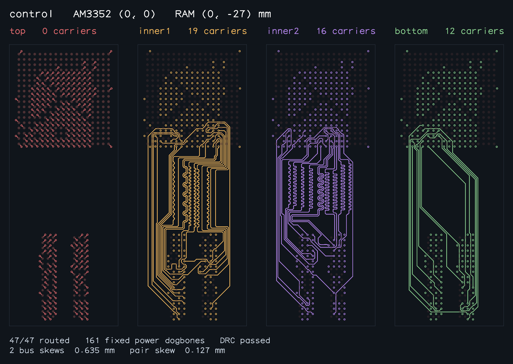
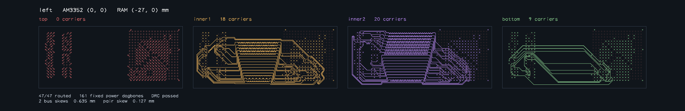
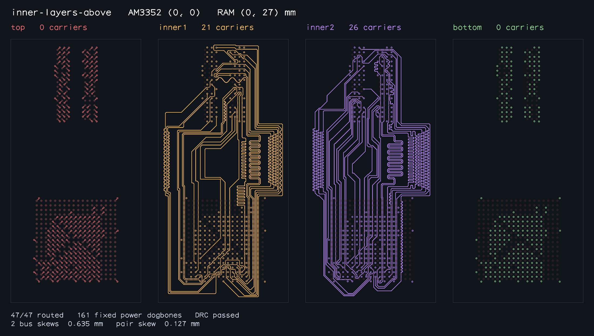
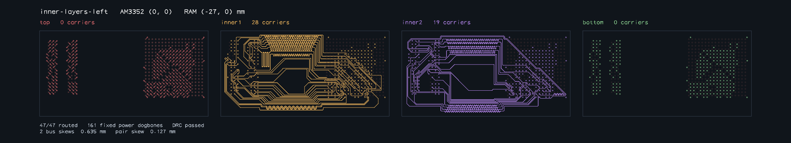
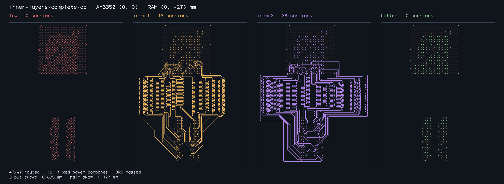

# Eleven-sample benchmark performance

Solver runtime fell from **2371.601s to 1646.858s (30.56% less time; 1.440× speedup)**.
All eleven unchanged AM3352 placements complete 47/47 signals, preserve the fixed power dogbones, and pass connectivity, combined copper DRC, full-copper length matching and coupling checks. Ordered output JSON and solver iteration counts match the baseline for every sample.

Worker time including fixture loading and validation: 2431.766s → 1704.913s (29.89% less time).

## Method

- Baseline: `81256f907408004329344fd4731bfe29f8d47534` (`v0.0.29`).
- Optimized solver: `34a61baf9f182be9c8bb35eeb4bf9503a03bd3f3`.
- Bun 1.3.2, macOS arm64, same runtime dependencies for both revisions.
- One full run per revision. Each revision runs the eleven samples serially in fresh processes; the two revisions ran concurrently. These are single-run measurements and can vary with host load.
- The baseline uses the same unchanged trusted benchmark harness and fixture set through `--solver`. Search budgets and physical tolerances are unchanged.

## Changes

- Query spatial bounds before exact copper-pair and long-path self-clearance checks. Copper conflicts retain the original first-hit order.
- Reuse immutable trace copper, spatial indexes and request-local weak conflict caches.
- Skip native carrier moves already dominated by a cheaper or shorter label before checking their geometry; keep the original floating-point addition order.
- Compact Pareto label arrays in place while preserving immutable predecessor labels and stable priority ordering.
- Remove collision rows only from the variables they touch, rather than scanning every model variable for every row.
- Name an existing inferred dogbone return type so generated declarations remain portable.

## Results

| Sample | Baseline (s) | Optimized (s) | Time reduction | Total copper bus skew (mm) |
| --- | ---: | ---: | ---: | --- |
| [control](snapshots/control-solved.png) | 30.319 | 25.977 | 14.32% | DDR_BYTE0: 0.635000; DDR_BYTE1: 0.635000 |
| [control-inner1](snapshots/control-inner1-solved.png) | 1081.560 | 487.520 | 54.92% | DDR_BYTE0: 0.635000; DDR_BYTE1: 0.635000 |
| [right](snapshots/right-solved.png) | 26.634 | 20.196 | 24.17% | DDR_BYTE0: 0.635000; DDR_BYTE1: 0.635000 |
| [left](snapshots/left-solved.png) | 28.290 | 24.803 | 12.33% | DDR_BYTE0: 0.635000; DDR_BYTE1: 0.511147 |
| [above](snapshots/above-solved.png) | 38.323 | 31.656 | 17.40% | DDR_BYTE0: 0.635000; DDR_BYTE1: 0.635000 |
| [inner-layers](snapshots/inner-layers-solved.png) | 41.985 | 37.804 | 9.96% | DDR_BYTE0: 0.635000; DDR_BYTE1: 0.635000 |
| [inner-layers-right](snapshots/inner-layers-right-solved.png) | 71.766 | 59.888 | 16.55% | DDR_BYTE0: 0.635000; DDR_BYTE1: 0.635000 |
| [inner-layers-left](snapshots/inner-layers-left-solved.png) | 126.332 | 123.363 | 2.35% | DDR_BYTE0: 0.634990; DDR_BYTE1: 0.634992 |
| [inner-layers-above](snapshots/inner-layers-above-solved.png) | 171.971 | 148.433 | 13.69% | DDR_BYTE0: 0.634991; DDR_BYTE1: 0.634992 |
| [inner-layers-complete-ca](snapshots/inner-layers-complete-ca-solved.png) | 172.878 | 151.425 | 12.41% | DDR_BYTE0: 0.634990; DDR_BYTE1: 0.634992; DDR_ADDR_CTRL_CK: 0.634993 |
| [outer-layers](snapshots/outer-layers-solved.png) | 581.543 | 535.792 | 7.87% | DDR_BYTE0: 0.635000; DDR_BYTE1: 0.635000 |
| **Total** | **2371.601** | **1646.858** | **30.56%** | All original limits pass |

Per-sample input and output hashes, iteration counts, bus skews and differential-pair skews are in [comparison.json](comparison.json). Full per-member copper lengths and all independent validation reports are in [baseline.json](baseline.json) and [optimized.json](optimized.json).

## Validation

- GitHub Actions: 496 tests passed, zero failed, including the complete compressed real-board fixtures.
- Typecheck and formatting passed.
- `bun run test:package` passed: build, generated declarations, and isolated Node, browser and TypeScript consumers.
- `./benchmark.sh` completed all 11 cases for both revisions. Complete ordered output JSON and iteration counts are identical in all 11 comparisons.
- Snapshots are exported from saved completed outputs through `exportAm3352RoutedSnapshots`, which independently revalidates success, complete connectivity, DRC and matching across the full declared sample set before writing files.

## Reproduce

```sh
git worktree add /tmp/bus-lanes-baseline 81256f907408004329344fd4731bfe29f8d47534
(cd /tmp/bus-lanes-baseline && bun install)
./benchmark.sh --solver /tmp/bus-lanes-baseline/lib/index.ts --output baseline.json --routes-directory baseline-routes --require-all-solved
./benchmark.sh --output optimized.json --routes-directory optimized-routes --require-all-solved
```

## Routed snapshots

All eleven images were visually inspected after the successful full-set export gate.

### control-inner1


### control



### left



### above


### right


### outer-layers


### inner-layers


### inner-layers-right


### inner-layers-above



### inner-layers-left



### inner-layers-complete-ca


