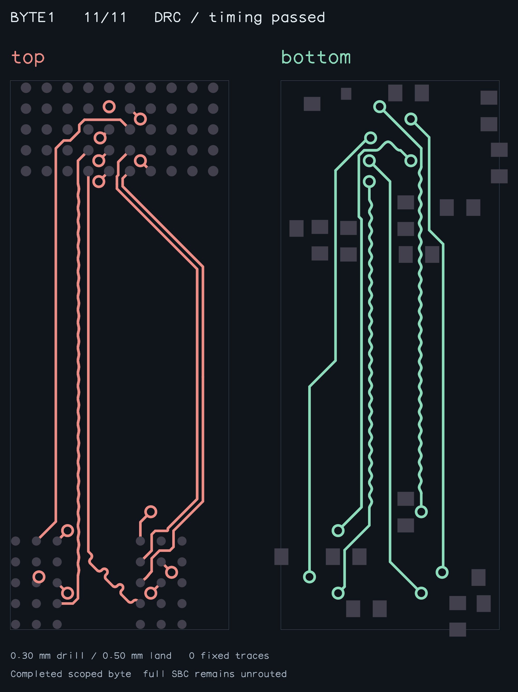

# Completed native DDR byte

This is a completed **DDR_BYTE1-only** solve from the existing public native
fixture, using 0.30 mm drills / 0.50 mm lands. The full SBC is not routed.
The snapshot shows actual copper on top and bottom; no search geometry is shown.

Regenerate with `bun scripts/snapshot-native-ddr-byte.ts`. The exporter refuses
incomplete solves, broken endpoints, changed inputs/fixed copper, failed native
copper DRC, bus length/skew violations, or differential skew/coupling failures.
[Audit and input hash](byte1-audit.json) identify this fresh solve. The exported
PNG was visually inspected. Independent whole-copper measurements can differ
from the pipeline's earlier carrier-stage statistics; the audit uses the final
published pad-to-pad traces.

The sequential regression freshly solves this first byte and passes exactly
its computed copper to DDR_BYTE0. The collective native-layer fallback fixes
that second phase's local escape assignment. It does not establish completed
routing or matching of the second byte.
