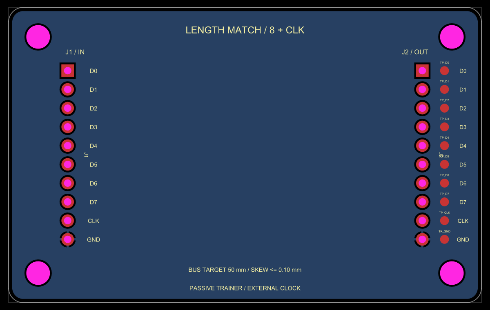
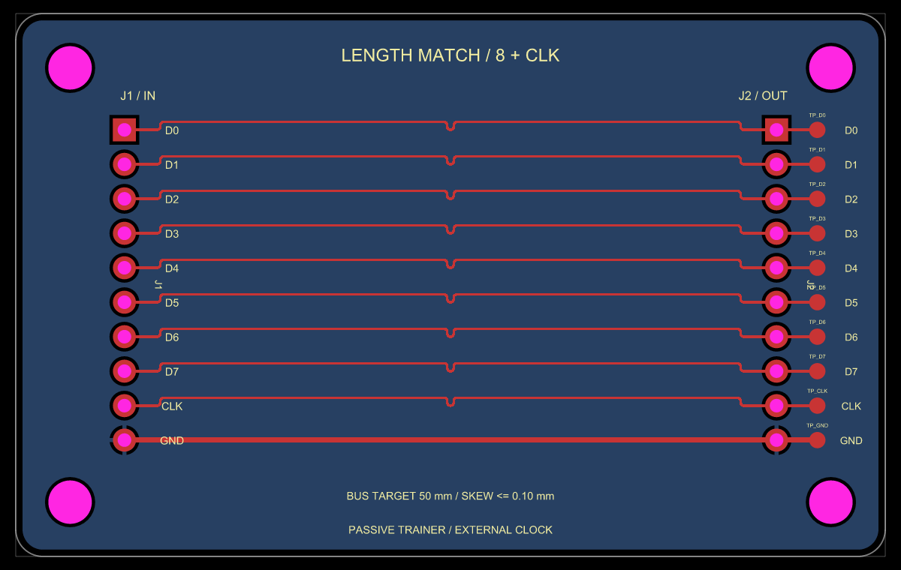

# Rounded board outline regression

Both snapshots are real PCB renders of the same passive 64 × 40 mm trainer
with `borderRadius="2mm"`: D0–D7 and CLK run between two 2.54 mm headers,
with probe branches routed in a subsequent explicit phase.

| Before | After |
| --- | --- |
|  |  |

The before image intentionally records the requested failure: base revision
`48ae81ecff13b155fd1a49cf9b1e1109255566a1` returns `unsupported_outline`
before producing a bus route. The after image retains the rounded boundary and
completes all nine signal lanes, probe branches, and ground connections. Each
main signal is 49.50 mm long, within the requested 50 ± 0.5 mm window and
0.10 mm skew. Core reports no circuit errors for the completed image.

The comparison uses `@tscircuit/core` 0.0.2203 and `circuit-to-svg` from
tscircuit 0.0.3016. The `bus-lanes` platform autorouter is supplied by the
corresponding checkout's `BusLanesPipelineSolver`; other routing remains
unchanged. `trainer.circuit.tsx` is the rendered source. The SVG originals are
retained beside the PNG previews. Schematic output is unaffected by this PCB
routing change.

`tests/board-outline.test.ts` contains the standalone solver regression with
the same board dimensions, corner radius, lane positions, and timing window, plus independent copper
clearance and boundary acceptance assertions:

```sh
bun test tests/board-outline.test.ts
```
