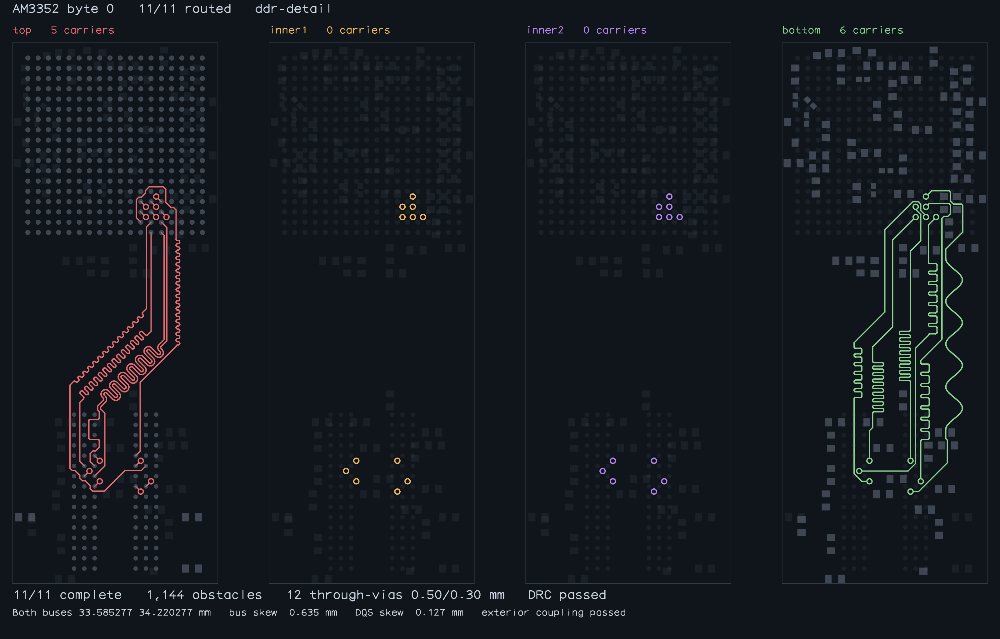
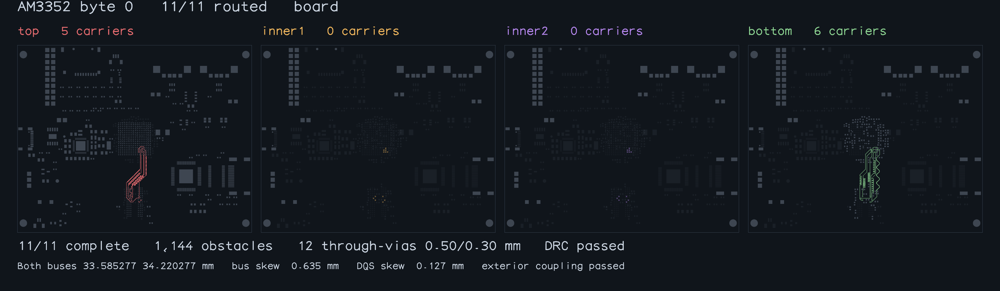

# Native AM3352 byte routing

The exact 11-signal CLI capture from `astra/am3352-sbc`, with all 1,144 obstacles
and no supplied copper. The fixture and its physical constraints are unchanged.
This verifies one byte phase; the complete board has not been rerouted here.

| Check | Accepted output |
| --- | --- |
| Connectivity | All 11 original TOP pad pairs |
| Carriers | 5 TOP, 6 BOTTOM |
| Vias | 12 full-through, 0.50 mm land / 0.30 mm drill |
| Whole-copper bus windows | Both 33.585277–34.220277 mm |
| Bus skew limit | 0.635 mm |
| DQS skew limit | 0.127 mm |
| Exterior coupling | Zero separated exterior length |
| Independent checks | Copper, drill/NPTH, board edge and routing quality |

The original native build timed out after 1,800.592 seconds. The fixed public
pipeline completes this capture in seconds; exact runtime and measurements are
retained in `benchmark-result.json` and `byte-validation.json`.





Both images were inspected. Their exporter refuses incomplete, unmatched or
invalid copper. The inner-layer views show the same full-through signal vias;
they contain no inner-layer carriers.

```sh
bun test tests/am3352-byte-stall-complete.test.ts
bun scripts/repro-am3352-byte-stall.ts --case native --steps 16000 --seconds 120 \
  --artifacts-directory docs/routed-am3352-byte
```

The legacy 47-signal placement inputs and their accepted reference artifacts
remain unchanged in [routed-am3352-placements](../routed-am3352-placements).
Their smaller drills and reduced obstacle scene are distinct from this capture.

The final 180-second-per-case comparison preserves all six baseline passes;
the same five cases time out. Every accepted result passes all 47 connections,
combined-copper DRC and whole-copper bus/pair matching. All eleven input hashes
and all 161 fixed power fanouts per sample remain unchanged. See the
[comparison](legacy-placement-comparison.md),
[unrounded metrics and provenance](legacy-placement-comparison.json), and
[complete candidate report](legacy-placement-benchmark.json).
