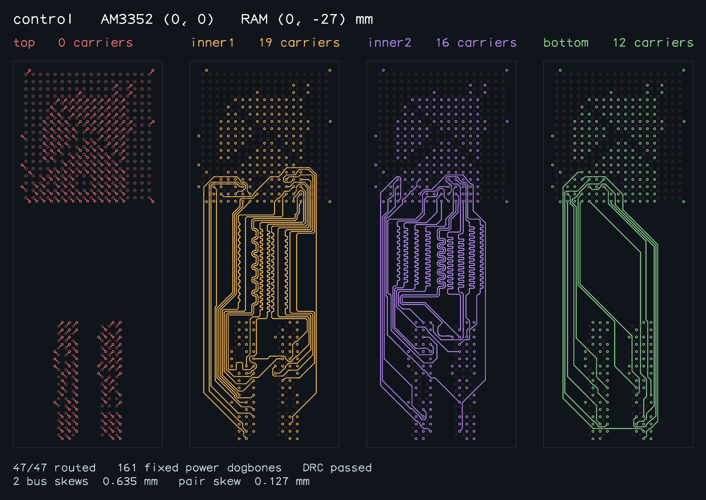
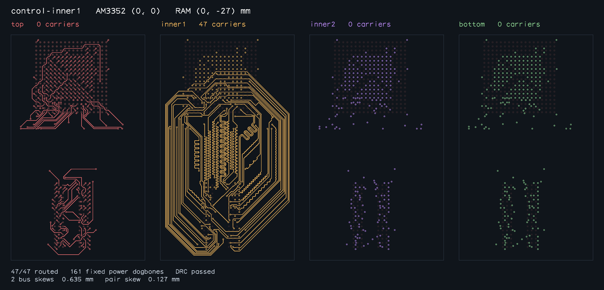
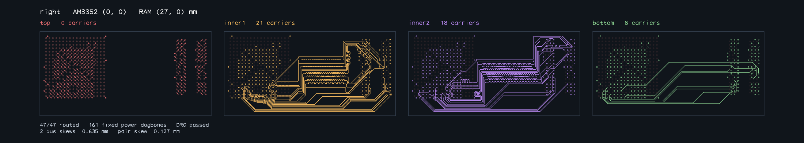
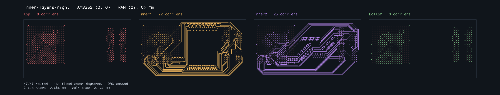
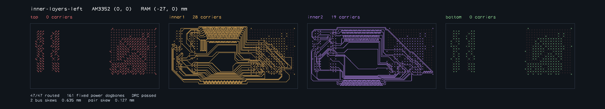
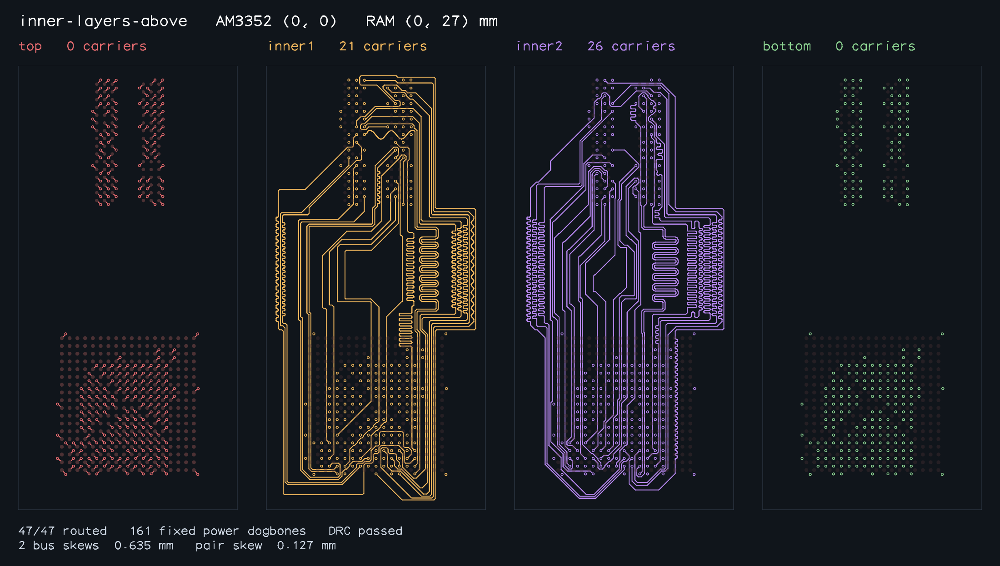
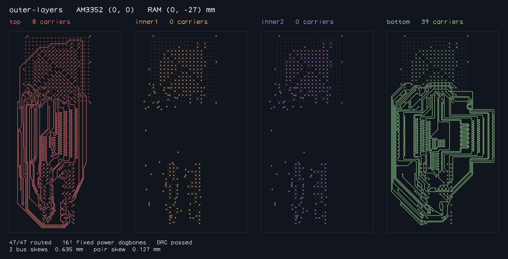

# Legacy AM3352 regression proof

All **11/11** unchanged legacy placements complete 47/47 signals and pass
independent connectivity, combined copper DRC, total copper length matching
and differential coupling checks. Every case preserves the 161 supplied power
dogbones and their pad joins. Only completed validated routes are shown.

Solver source: `cda168704d44104e2ca5f8f4a2d15224312170de` (stacked fix #67).
Runtime: Bun 1.4.0, up to three concurrent benchmark workers, 3,600 seconds per
case. These wall times are correctness-run measurements; they are not a paired
performance comparison with the earlier serial proof.

These are the original legacy fixtures (0.15 mm drills / 0.30 mm lands). The
separate real SBC input has 46 matched DDR signals, 1,144 obstacles and 0.30 mm
drills / 0.50 mm lands. Its layer/dispatch regression passes, but no complete
real-DDR route is claimed by this gallery.

| Sample | Solve seconds | Signals | Copper DRC | Total copper bus skew (mm) |
| --- | ---: | ---: | --- | --- |
| [control](control-solved.png) | 45.351 | 47/47 | pass | DDR_BYTE0: 0.635000<br>DDR_BYTE1: 0.635000 |
| [control-inner1](control-inner1-solved.png) | 1703.004 | 47/47 | pass | DDR_BYTE0: 0.635000<br>DDR_BYTE1: 0.635000 |
| [right](right-solved.png) | 35.221 | 47/47 | pass | DDR_BYTE0: 0.635000<br>DDR_BYTE1: 0.635000 |
| [left](left-solved.png) | 46.624 | 47/47 | pass | DDR_BYTE0: 0.635000<br>DDR_BYTE1: 0.511147 |
| [above](above-solved.png) | 50.920 | 47/47 | pass | DDR_BYTE0: 0.635000<br>DDR_BYTE1: 0.635000 |
| [inner-layers](inner-layers-solved.png) | 65.603 | 47/47 | pass | DDR_BYTE0: 0.635000<br>DDR_BYTE1: 0.635000 |
| [inner-layers-right](inner-layers-right-solved.png) | 99.729 | 47/47 | pass | DDR_BYTE0: 0.635000<br>DDR_BYTE1: 0.635000 |
| [inner-layers-left](inner-layers-left-solved.png) | 257.058 | 47/47 | pass | DDR_BYTE0: 0.634990<br>DDR_BYTE1: 0.634992 |
| [inner-layers-above](inner-layers-above-solved.png) | 314.099 | 47/47 | pass | DDR_BYTE0: 0.634991<br>DDR_BYTE1: 0.634993 |
| [inner-layers-complete-ca](inner-layers-complete-ca-solved.png) | 312.506 | 47/47 | pass | DDR_BYTE0: 0.634990<br>DDR_BYTE1: 0.634992<br>DDR_ADDR_CTRL_CK: 0.634994 |
| [outer-layers](outer-layers-solved.png) | 1050.865 | 47/47 | pass | DDR_BYTE0: 0.635000<br>DDR_BYTE1: 0.635000 |

The original per-bus skew limits remain unchanged (0.635 mm), with paired
skew/coupling and all fixed copper included in validation. Full measurements,
per-member lengths and checks are retained in [benchmark-results.json](benchmark-results.json).
[Provenance](run-provenance.json) and [PNG hashes](artifact-manifest.json) identify
this exact run. All eleven PNGs were visually inspected after export. Fresh trace arrays for
all eleven cases exactly match the previous successful proof; see
[baseline-comparison.json](baseline-comparison.json).

Reproduce each unchanged case with:

```sh
./benchmark.sh --worker <sample> --timeout-seconds 3600 --routes-directory /tmp/am3352-routes
```

The complete serial equivalent is `./benchmark.sh --timeout-seconds 3600 --require-all-solved`.
Snapshots are exported from saved successful outputs through the existing
`exportAm3352RoutedSnapshots` gate, which independently revalidates every case.

## control



## control-inner1



## right



## left


## above


## inner-layers


## inner-layers-right



## inner-layers-left



## inner-layers-above



## inner-layers-complete-ca


## outer-layers


